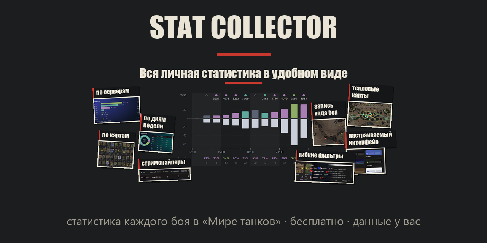

# Stat Collector

**Подробная статистика каждого вашего боя в «Мире танков» — на вашем компьютере, бесплатно, без регистрации.**

Мод запоминает каждый бой: карту, респ, кто вас убил и кого убили вы, оба состава, урон, ассист, WN8. Всё это листается в дашборде: в окне поверх игры
(клавиша **F10**) или в браузере (**F9**).

> Неофициальный мод. С Lesta Games не связан. Репозиторий содержит только готовые сборки; исходный код не публикуется.

## Что умеет

- **Каждый бой, а не профиль:** карта, режим, результат, респ (сторона и координаты), урон, фраги, ассист, заблокировано, засвет, опыт, серебро, WN8 за бой,
  награды, знак классности, отметка на орудии, очки Натиска.
- **Оба состава:** танки, уровни, классы, взводы, WN8 и винрейт игроков; «кто меня убивал» и «кого убивал я».
- **Сводка:** график по часам суток (пять видов), победы и поражения по сессиям, дням недели, танкам, картам и уровням, «цена смерти» (сколько урона
  стоит ранняя смерть), по серверам и по типам техники.
- **Карты:** тепловые карты маршрута, смертей, убийств, засветов, полученного и нанесённого урона; запись хода боя на карте с HP по времени.
- **Игроки:** с кем и против кого встречались, повторные встречи, заметки и оценки.
- **Несколько аккаунтов**, гибкие фильтры (карта, танк, уровень, нация, сессия, респ, дата и время суток), своё оформление и фон.

## Установка

1. Скачайте `stat_collector.mtmod` на странице **[Releases](../../releases/latest)**.
2. Положите файл в папку модов игры: `<папка игры>\mods\<версия игры>\` (например `D:\Games\Tanki\mods\1.45.0.0\`).
3. Полностью перезапустите игру и зайдите в ангар — появится сообщение «Stat Collector загружен».
4. **F9** — дашборд в браузере. **F10** — тот же дашборд окном поверх игры (игра должна идти в оконном режиме или «окно без рамки»). Клавиши и остальное меняются в `mods\configs\statcollector\config.json`.
5. Дашборд можно встроить прямо в клиент (как у автора): в `config.json` поставьте `"enable_gameface_widget": true` и `"ingame_dashboard_mode": "gameface"`, перезапустите игру. Режим экспериментальный; если клиент начнёт падать, верните прежние значения.

Данные лежат в `mods\configs\statcollector\data\` и не удаляются при обновлении мода.

## Приватность

- Данные ваших боёв хранятся только на вашем компьютере.
- Для WN8 и винрейта других игроков мод обращается к открытым источникам статистики (KTTC; при желании к API Lesta с вашим собственным ключом).
  Ваши данные боёв при этом никуда не отправляются.
- Дашборд раздаётся только на этом же компьютере (локальный адрес).

## Поддержать

Мод бесплатный и останется таким. Поддержка добровольная:
[Boosty](https://boosty.to/statcollector) · [Patreon](https://www.patreon.com/c/StatCollector)

## Новости и связь

[Telegram](https://t.me/StatCollector) · [VK](https://vk.ru/wotstatcollector) · [Issues](../../issues)
